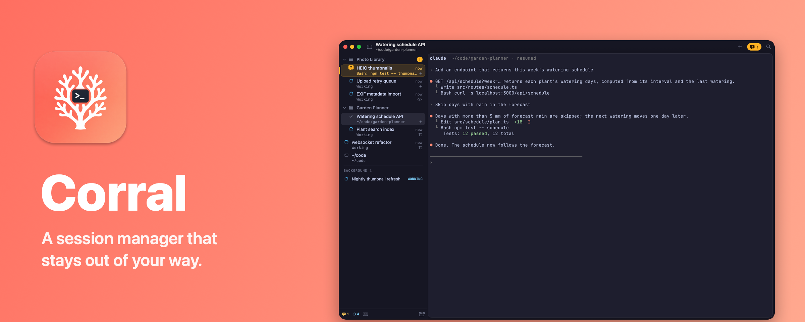

# Corral



Native macOS app that herds Claude Code, OpenCode and PI sessions: every session is a real
Ghostty terminal (embedded libghostty), listed in a sidebar with a live status icon in front of
its name. Sessions can be grouped in folders, dragged around, closed, searched and reopened.

## Status icons

Shape, size and motion carry the state, not hue alone; amber is reserved for needs-input.

| Icon | Meaning |
|---|---|
| amber bubble with halo + slow ping, bold title, amber subtitle | agent **needs input** (permission prompt, question) |
| spinning ring | working (subtitle shows the current tool) |
| filled green disc | finished while you were elsewhere (unread) |
| small tertiary check | finished, seen |
| red triangle (short shake on arrival) | error / long shell command failed |
| stop circle, dimmed row | agent exited |
| agent glyph (sparkle, `</>`, `π`, terminal) | idle |

Only the working spin and the needs-input ping loop, both at ≤ 30 fps, phase-synced, and only
while visible; everything else is a one-shot transition. Reduce Motion is honored. The chrome
(sidebar, toolbar, panels) derives its colors from the Ghostty theme (OKLab ramps, contrast-checked),
the terminal sits in a floating card.

Folders show an amber count of sessions needing input, also when collapsed; edge chips point to
needs-input rows scrolled out of view, and the toolbar shows an attention capsule. The Dock badge
counts sessions needing input. macOS notifications fire when a session you are not looking at
asks for permission, asks a question, finishes or fails (Settings › Notifications); clicking one
opens that session. Claude Code permission notifications have Allow and Deny: Allow types `1` (Yes)
into that session, Deny presses Esc and brings Corral forward; neither does anything once the prompt
is gone (answered, or another one up), then the click just opens the session. ⌘I jumps to the next session that wants you.

Where status comes from:

1. **Agent hooks** (exact). Settings › Agents (or the sidebar banner, shown only for agents set up on
   this Mac) adds Claude Code hooks to
   `~/.claude/settings.json` (backup kept), an OpenCode plugin (`~/.config/opencode/Plugins/corral.js`)
   and a PI extension (`~/.pi/agent/extensions/corral.ts`). All are no-ops outside Corral
   (they check `CORRAL_SURFACE_ID` / `CORRAL_HOOK`). They report over a Unix socket
   (`~/Library/Application Support/Corral/corral.sock`).
2. **Terminal signals** (fallback without hooks): OSC 9/777 notifications, bell, OSC 9;4 progress,
   shell-integration command-finished, the terminal's foreground process (detects `claude`,
   `opencode`, `pi` starting/exiting), and the direct-launch script's agent exit report.
3. **Claude background jobs** (`claude --bg`): listed under *Background agents* from
   `claude agents --json`, refreshed on FSEvents in `~/.claude/jobs` (no polling). Attach opens
   `claude attach <id>` in a session.

## Terminal

Each session is a libghostty surface running your login shell, so your Ghostty config
(`~/.config/ghostty/config`, theme, font, keybinds) and zsh setup (p10k incl. command execution
time, fzf history widgets, autosuggestions) work as in Ghostty.app. Corral-only Ghostty overrides
can go in `~/.config/corral/ghostty`.

Agent sessions open straight into the agent. With zsh as login shell (the macOS default) the
terminal runs a small launch script instead of a bare shell: the agent starts in an interactive
login zsh (`zsh -lic`), so your rc files load (aliases, PATH), the agent is the terminal's
foreground process, and no prompt or typed command ever shows. Anything your rc files print, and
the "Last login" line on systems without `~/.hushlogin`, appears before the agent and drops the
cover early. Until the agent draws its first frame, a cover sits over the
terminal (agent glyph, *Starting Claude Code* / *Resuming OpenCode* / *Attaching to background
agent*, the directory, a working ring) and the sidebar row reads *Starting…*; it dissolves on the
first output, a hook, a title, a key press or click, or after 4 s at the latest. The terminal keeps
rendering underneath, so the agent's first frame is already there. When the agent exits (also when
Ctrl-C kills it or interrupts the rc files) the script reports the exit status to Corral and
`exec`s your login shell with Ghostty shell integration, so the session carries on as a normal
shell; `exit` there closes the session as usual. Ctrl-Z suspends the agent as at a prompt, but with
no prompt to `fg` from it is resumed right away (and, as at a prompt, the rest of a multi-command
agent line runs on). That needs the agent to be a job of the launch shell: if your rc files wrap
`claude`/`opencode`/`pi` in a shell function, Ctrl-Z ends the agent instead (use an alias).
The launch shell never shows a prompt, so prompt-time setup never finishes; Corral stops
powerlevel10k's gitstatus daemon itself when the launch shell exits. Other login shells (bash,
fish) keep the typed fallback: the command is typed into the shell's first prompt, no cover.

Ghostty keybinds map onto sessions: ⌘T new shell, ⌘W close, ⌘1…8 select the Nth session in
sidebar order (⌘9 = last; holding ⌘ shows the numbers on the rows), ⌘⇧[ ⌘⇧] previous/next,
⌘⇧T reopen last closed, ⌘F find in scrollback. Corral adds ⌘K (search all sessions; Ghostty's clear screen moves to ⇧⌘K), ⌘I (next
needing input), ⌃⌘C / ⌃⌘O / ⌃⌘P (new Claude / OpenCode / PI session), ⌥⌘T (new session in a
directory), ⇧⌘N (new folder), ⇧⌘R (rename), ⇧⌘E (focus sidebar), ⌃⌘S (toggle sidebar),
⌘, (Corral settings), ⌥⌘, (open Ghostty config). Ghostty bindings that also have a Corral menu
item go through the menu (as in Ghostty.app), so ⌘W gets Corral's busy-agent confirmation.
⌥⌘←↑↓→ (Go › Focus …) move to the terminal on that side of the focused one (a pane or a session side
by side, by position, not reading order); off the card's top or bottom, or with nothing split,
⌥⌘↑ / ⌥⌘↓ go on to the previous / next session in the sidebar (rows as shown, the card's own sessions
skipped, no wrap-around). Positions are the real ones (dragged dividers count); a tie goes back where
focus came from. From the sidebar they move the selection between sessions and keep the keyboard
there. Being menu items, they win over your own Ghostty bindings on ⌥⌘ arrows (remap them in Settings ›
Shortcuts to give the keys back to the terminal).
Ghostty handles ⌘K and ⇧⌘T itself ("performable" bindings), so Corral layers a small defaults file
(`~/Library/Application Support/Corral/ghostty-defaults`) that unbinds them; `~/.config/corral/ghostty`
loads after it. ⌘/ (or the keyboard icon next to the sidebar counts) shows every shortcut.

**Settings (⌘,).** A nav column and a card, like the main window:
- *General*: keep the Mac awake while agents work (an idle-sleep assertion, like `caffeinate -i`,
  held only while a session runs an agent turn or a background job is active, never while one waits
  for permission or input; the display can still sleep), rebuild the search index, and (when
  `claude-sessions` is installed) take over its sessions.
- *Notifications*: on/off and sound per event (permission requests, questions, finished turns,
  errors, long shell commands) and whether they also come while Corral is in front. Never for the
  session on screen; one per session (a newer one replaces it), withdrawn once a question is answered.
  macOS asks for permission the first time there is something to show (or via Allow… / Send Test).
- *Agents*: per kind, the start directory, the sidebar folder, and one-click status hooks.
- *Shortcuts*: every menu command. Click a shortcut and type the new keys; ⌫ removes it, esc
  cancels, ↺ restores one, Restore Defaults all. A shortcut another command has moves (that one is
  left without and flashes). Shortcuts need ⌘ (⌃ and ⌥ alone belong to the terminal; F-keys work on
  their own); standard macOS ones (⌘C/V/A/H/M/Q, ⌘X/Z, full screen, screenshots) and ⌃↩ can't be
  taken. Session 1–9 change together, modifiers only. Stored in the `CorralShortcuts` user default;
  the keys a custom shortcut moves to or away from are unbound in Ghostty, so the new key works over
  a terminal and a freed one reaches the terminal. Customize… in the ⌘/ sheet opens this page.
- *Terminal*: open or create the Ghostty config and Corral's own overrides, reload, login shell.

**Split panes.** ⌘D splits the focused terminal to the right, ⇧⌘D down: a plain shell in the
session's current directory, for a quick command next to an agent. ⌘] / ⌘[ move between panes, ⌘W
or `exit` closes the focused pane, and a session's panes close with it. Panes are throwaway (not
restored after a relaunch).

**Sessions side by side.** Several sessions can share the card: drag a session from the sidebar onto
the terminal (the half it will take lights up; drop on any side), use *Show Side by Side* in its
context menu, or start an agent in a ⌘D pane (it becomes a session of its own, listed right after
the first, and stays where it is). Clicking into a terminal on the card selects its session; ⌘] / ⌘[
walk across sessions and panes. Sessions on screen next to the selected one get a quieter row fill,
count as looked at (no unread mark, no notification), and *Show Separately* gives one its own card
again. Closing one leaves the card to the others. Which sessions share a card is restored after a
relaunch (they start together); shell panes are not.

Links printed by programs (OSC 8) or detected in output follow Ghostty.app's policy: web and
mail links open, other schemes ask first, executables and links with hidden characters are refused.

## Sessions, folders, closing

- Folders nest; drag sessions and folders to reorder or regroup. A folder can have a default
  directory for new sessions inside it.
- Default folder per agent (Settings ⌘, or folder context menu → *Default Folder for New*):
  new Claude / OpenCode / PI sessions or shells can start in a fixed directory (e.g.
  `~/Documents/Code`) and land in a chosen sidebar folder. Precedence for the start directory:
  explicit choice > the folder's own directory > the agent default > the selected session's
  directory > home.
- Closing a session that ran an agent (⌘W) moves it to *Closed*; it reopens with `claude --resume`,
  `opencode -s` or `pi --session`. A plain terminal that never ran an agent is simply gone when
  closed, and so is a session whose conversation doesn't exist (a resume that printed "No
  conversation found"; checked against the transcript files, never when they can't be read). A session keeps its agent's name after the agent exits (the shell's directory titles
  don't rename it); closed background sessions are named after their job.
  Drag a closed session back into the tree to reopen it there.
- On quit/relaunch every open session comes back; agents that were running are resumed (launched
  directly, see Terminal). The session on screen resumes first, the others two at a time (each
  `claude --resume` replays its whole transcript; all at once they starve each other); clicking a
  queued one resumes it right away. A resume keeps its cover until the replayed screen has stopped
  changing, so the finished conversation appears at once instead of being drawn line by line.

## Taking over from claude-sessions (Ghostty)

`Session → Import from claude-sessions…` reads the Ghostty restore tracker
(`claude-sessions list --json`) and moves its sessions into Corral, into a *From Ghostty* folder:
sessions not running anywhere are resumed (`claude --resume`, background ones restarted with
`claude --bg --resume` and attached), running background jobs are attached in place. Each one is
then removed from the tracker (`claude-sessions forget`) so Ghostty never reopens it as well.
Sessions still running in a Ghostty tab are left alone (a live process can't move, and resuming
it twice would give two writers): quit Ghostty first, which marks them restorable, then import.

## Search (⌘K)

SQLite FTS5 index (`~/Library/Application Support/Corral/index.sqlite`) over:
Claude transcripts (`~/.claude/projects/*/*.jsonl`: prompts, answers, Bash commands; no tool
output, no thinking), OpenCode (`~/.local/share/opencode/opencode.db`, read-only), PI
(`~/.pi/agent/sessions`), and the final scrollback of closed shell sessions. Incremental
(byte offsets / watermark), triggered by FSEvents. Enter on a result focuses the open session,
reopens a closed one, or resumes the transcript in a new session.

Each result shows how many messages matched and its two best distinct passages, cleaned up to
read like prose (no markdown link syntax, image badges or HTML; commands and terminal output stay as
typed) and starting at the match. → shows the session's details in place of the list: directory,
session id, when it started and was last active, and every matching message in order with its
role, time and context (selectable, so you can copy from it). ↑↓ browse the other results' details,
← or esc go back, ↩ opens as usual.

## Install

Download `Corral-<version>.dmg` from [Releases](https://github.com/MartinWie/Corral/releases), open it
and drag Corral onto Applications. It is signed with a Developer ID and notarized by Apple, so it opens
without warnings. Apple Silicon, macOS 15 or later. Bring your own Claude Code / OpenCode / PI (any
install method on your shell's PATH); nothing else is needed (no Ghostty.app, Homebrew, fonts or
terminfo).

## Updates

Corral checks GitHub once a day (Settings › General › Updates, or Corral › Check for Updates…) and
offers new versions through [Sparkle](https://sparkle-project.org). Nothing installs on its own: each
update asks first (Install Update, Remind Me Later, Skip This Version). Each update is a zip on GitHub
Releases with an EdDSA signature; Corral installs it only when that signature matches the public key
built into the app. Every release is signed with the same Developer ID, so macOS privacy permissions
(Desktop, Documents, …) carry over.

## Releasing

```sh
# bump VERSION, write release-notes/<version>.md, commit and push main, then:
scripts/release.sh   # tests, build, leak scan, Developer ID signature, notarized app + DMG,
                     # EdDSA-signed zip, appcast.xml, GitHub release
```

Once per Mac that releases: a Developer ID Application certificate in the keychain, notarization
credentials (see the top of `scripts/release.sh`) and the Sparkle key in the login keychain
(`generate_keys --account corral -f <exported key>`, tools via `scripts/sparkle-tools.sh`). Version: `VERSION` (marketing), build number = commit count,
`CorralCommit` = exact source. `scripts/notices.py` regenerates `Resources/app/THIRD_PARTY_NOTICES.txt`
after changing Ghostty or Sparkle.

libghostty is built without GNU gettext (LGPL) and Sentry. Opened from Finder, Corral reads PATH,
`CLAUDE_CONFIG_DIR` and `XDG_*` from the login shell once (cached in Application Support,
refreshed in the background) to find `claude` and its config; terminals still start their own login
shells. Ghostty's `ssh-env` / `ssh-terminfo` shell-integration features need the `ghostty` CLI,
which Corral doesn't ship, so Corral turns just those two off (keeping the user's other features).

## Quality gates

```sh
scripts/test.sh        # all tests: core, session manager + UI with fake terminals, C hook
scripts/coverage.sh    # line coverage gate ≥ 90% on CorralCore + CorralKit (currently 95%)
scripts/perf.sh        # release perf budgets in isolation; --app also runs the real app headless
scripts/snapshots.sh   # renders sidebar/window/panel galleries to PNG (offscreen) for visual review
```

Everything above the terminal (session manager, sidebar, search, settings, window) lives in
`CorralKit` behind `TerminalSurface`, so it is tested headlessly with fake terminals. The
libghostty glue (`Sources/Corral`) is exercised by `scripts/perf.sh --app` (`CORRAL_BENCH`):
launch, session create → shell ready, command round trip, switching, status updates, idle CPU,
close, memory — against throwaway state, invisible window, no focus change.

Budgets (release, fake terminals, full UI live; measured p95 in brackets): create session < 5 ms
[3.3 with 150 sessions], switch < 4 ms [0.7], status update < 1 ms [0.06], sidebar in-place
refresh (200 open, 20 folders, 40 closed) < 16 ms [1.4], animated insert+remove < 16 ms [3.3],
full reload < 32 ms [1.0], sidebar diff plan < 1.5 ms [0.3], close incl. 10k-line scrollback
< 8 ms [2.0], hook → sidebar < 5 ms [0.13], search < 15 ms [1.8], corral-hook per call < 10 ms
[2–3], idle CPU < 2% [0.1].

Real terminals (`scripts/perf.sh --app`, 20 zsh sessions with p10k/zinit, release): launch
0.5–0.8 s, new session 12 ms p50 / 19 ms p95 on the main thread then shell prompt after
~300 ms (zsh startup; varies with machine load), command round trip 26–44 ms p50, switch
0.1–0.3 ms p50 / 2 ms p95, close 14 ms, ~15 MB per live terminal, idle CPU 0.8% with 20
terminals open (20 s window). Direct agent launch with a stub agent: first agent output after
~255 ms, cover gone ~310 ms (probe granularity), nothing on screen before the agent (the typed
path shows prompt + echoed command first), exit status reported, follow-up shell has Ghostty
integration (prompt ~270 ms after the agent exits). Real transcripts here: first index 750 MB
Claude + 1,335 OpenCode sessions in ~9 s at 82 MB peak, queries 6–15 ms.

## Build

Command Line Tools only (no Xcode).

```sh
scripts/build-ghostty.sh     # once: clones Ghostty v1.4.0, applies patches/ghostty-corral.patch,
                             # builds libghostty.a + resources with a local Zig 0.17.1
scripts/test.sh              # core tests (swift-testing)
scripts/bundle.sh --install  # dist/Corral.app → /Applications
scripts/make-signing-identity.sh  # once: stable local code signature (own keychain, no prompts)
```

Programs in Corral's terminals inherit Corral's macOS privacy permissions (Desktop, Documents, …).
With an ad-hoc signature every rebuild looks like a new app and macOS silently denies what it
allowed before ("Operation not permitted"); `bundle.sh` signs with "Corral Local Signing" when
`make-signing-identity.sh` has created it (a Developer ID in the keychain wins over both). After switching, reset the old decision once with
`tccutil reset SystemPolicyDesktopFolder dev.corral.app` (or Documents/Downloads) and allow the prompt.

`patches/ghostty-corral.patch` compiles Ghostty's Metal shaders at runtime (the CLT have no
`metal` compiler), installs a plain `libghostty.a` instead of an xcframework, and stops the embedded
apprt from forcing wait-after-command on surfaces started with a command (direct agent launch), so
they close on exit like shells.
Without `vendor/ghostty-out/lib/libghostty.a` the app target is left out of the package so
`scripts/test.sh` still works.

## Layout

- `Sources/CorralCore` – model (workspace tree, records), status reducer, hook wire format and
  socket, search index + transcript indexers, integrations installer, process inspection.
- `Sources/corral-hook` – plain-C hook binary (~2 ms) Claude hooks call synchronously; passes the
  hook JSON through to the socket.
- `Sources/CorralKit` – session manager, sidebar, search panel, settings, window, bench runner;
  terminal-agnostic (`TerminalSurface`).
- `Sources/Corral` – libghostty glue: runtime + terminal view (keyboard/IME/mouse ported from
  Ghostty's macOS SurfaceView), clipboard, `main.swift`.
