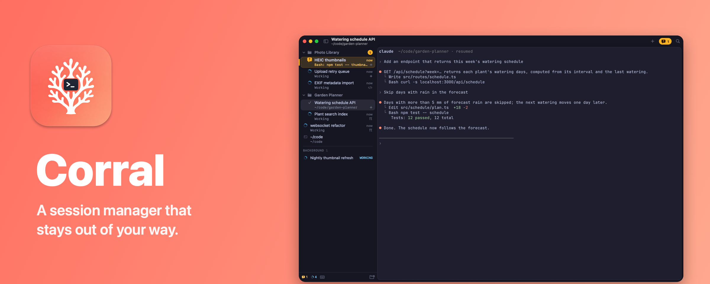

# Corral



A macOS app for your Claude Code, OpenCode and PI sessions. Every session is a real Ghostty terminal,
and the sidebar shows which agent is working, done or waiting for input.

## Install

1. Download `Corral-<version>.dmg` from [Releases](https://github.com/MartinWie/Corral/releases/latest).
2. Open it and drag Corral onto Applications.

Needs an Apple Silicon Mac with macOS 15 or later, and Claude Code, OpenCode or PI. Corral checks for
updates once a day and asks before installing one. No account, no analytics: the update check is the
only network request it makes.

## Getting started

1. Start an agent with **⌃⌘C** (Claude Code), **⌃⌘O** (OpenCode) or **⌃⌘P** (PI), or a plain shell with **⌘T**.
2. Install the status hooks when Corral offers them (in the sidebar, or Settings › Agents). With them
   the sidebar knows exactly when an agent works or waits for you.
3. Keep several sessions going. **⌘I** takes you to the one waiting for input, and every session comes
   back after a restart.

| Keys | Action |
|---|---|
| ⌃⌘C | New Claude Code session |
| ⌘T | New shell |
| ⌘I | Next session waiting for input |
| ⌘K | Search all sessions and conversations |
| ⌘1 … ⌘9 | Go to a session |
| ⌘D | Split the terminal |
| ⌘W | Close the session |
| ⌘/ | All shortcuts (change them in Settings › Shortcuts) |

Corral uses your Ghostty config (theme, font, keybinds) and your shell setup.

## Agents that start agents

Turn on **Settings › Agents › Command line** and install the skill there. A session can then hand work
to others and watch them, and so can a script:

```sh
corral spawn --model easy --name "Check the logs" "Why did the nightly import fail? Report the cause."
corral wait        # returns when a session you started needs permission, asks something or is done
corral approve ID  # or: deny, send, output, list, status, close
corral folder move "Nightly/Checks" ID   # group sessions in sidebar folders, collapse what you don't need to see
corral events --json   # every state change as a line: one watcher for many sessions
corral stats       # token use per session and flagged waste (Settings › Agents › Measure sessions)
```

Scripts get the outcome as exit status (`corral spawn --wait --done …`) or as `--json`.

`easy`, `medium` and `high` are the models you set per agent in Settings. The command is the app
itself (`~/.local/bin/corral`), so there is nothing else to install.

## Build from source

```sh
scripts/build-ghostty.sh      # once: builds libghostty into vendor/
scripts/bundle.sh --install   # builds Corral.app and copies it to /Applications
```

Command Line Tools are enough, no Xcode needed. Notes for working on the code:
[CLAUDE.md](CLAUDE.md) and [docs/internals.md](docs/internals.md).

## Credits

Terminals by [Ghostty](https://ghostty.org)'s libghostty, updates by [Sparkle](https://sparkle-project.org).
Licenses of everything Corral ships: [THIRD_PARTY_NOTICES.txt](Resources/app/THIRD_PARTY_NOTICES.txt).
